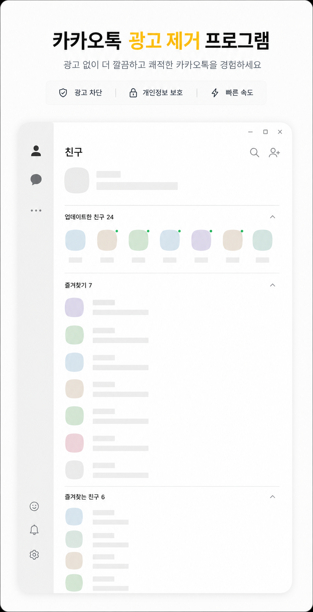

<div align="center">


# TalkShield (톡실드)

### PC 카카오톡 광고를 자동으로 제거하는 가볍고 빠른 프로그램

[](LICENSE)




*TalkShield 적용 후 — 하단 배너가 사라진 깨끗한 카카오톡*

</div>

---

## ✨ TalkShield란?

PC 카카오톡을 쓸 때마다 친구목록 아래에서 깜빡이는 배너 광고, 잠금화면 광고,
불쑥 나타나는 광고 팝업이 거슬리지 않으셨나요?

**TalkShield**는 실행해두기만 하면 카카오톡의 광고를 실시간으로 찾아 제거하고,
광고가 있던 자리를 친구목록으로 자연스럽게 메워주는 트레이 상주 프로그램입니다.

### 왜 TalkShield인가?

| | TalkShield |
|---|---|
| 🪶 **초경량** | 단일 실행 파일 약 60KB. 설치도, 별도 런타임도 필요 없습니다 |
| ⚡ **빠름** | 네이티브 코드로 동작하며 평소 CPU 점유율은 사실상 0%입니다 |
| 🛡️ **안전** | 카카오톡의 파일·메모리를 일절 건드리지 않습니다. 화면의 광고 창만 정리합니다 |
| 🤫 **조용함** | 시작 알림도, 귀찮은 팝업도 없습니다. 트레이에서 묵묵히 일만 합니다 |
| 🔋 **알뜰함** | 카카오톡이 꺼져 있으면 스스로 검사 주기를 늦춰 자원을 아낍니다 |
| 📊 **통계** | 트레이 아이콘에 마우스를 올리면 누적 차단 수를 보여줍니다 |

### 제거하는 광고

- ✅ 메인 창(친구목록/채팅목록) **하단 배너 광고** — 닫고 빈 자리를 메움
- ✅ **잠금화면 광고**
- ✅ 별도로 뜨는 **광고 팝업** (웹뷰 광고 포함)
- ✅ **카카오톡 베타**(새 PC 카카오톡, `KakaoTalkUI.exe`) 하단 배너 광고 — 광고와 빈자리를 함께 제거

채팅 내용·친구목록 등 실제 콘텐츠는 일절 건드리지 않습니다.
기존 카카오톡과 베타가 동시에 실행되어 있어도 각각 따로 처리합니다.

## 🚀 다운로드 & 실행

1. **[최신 버전 다운로드](../../releases/latest)** — `TalkShield-vX.X.X.zip` 을 받아 압축을 풉니다.
2. `TalkShield.exe` 를 더블클릭합니다.
3. 끝입니다. 카카오톡의 광고가 자동으로 사라집니다.

설치 과정이 없으므로 삭제도 간단합니다 — 프로그램 종료 후 파일을 지우면 끝.

> 💡 **트레이 아이콘이 안 보이나요?**
> Windows 11은 새 프로그램의 트레이 아이콘을 작업표시줄 `∧`(숨겨진 아이콘) 안에 넣습니다.
> `∧`를 눌러 노란 말풍선 아이콘을 **시계 옆으로 드래그**하면 항상 보이게 고정됩니다.

## 🖱️ 사용법

트레이 아이콘 **우클릭** 메뉴 (군더더기 없이 5개뿐):

| 메뉴 | 설명 |
|------|------|
| 광고 차단 사용 | 차단 켜기/끄기 (아이콘 더블클릭으로도 전환) |
| Windows 시작 시 자동 실행 | 부팅 시 자동 시작 등록/해제 |
| 트레이 아이콘 숨기기 | 아이콘만 감추고 차단은 계속 동작. 다시 보려면 `TalkShield.exe` 재실행 |
| 정보 | 개발자 블로그 열기 |
| 종료 | 프로그램 종료 |

- 아이콘이 **노란색**이면 켜짐, **회색**이면 꺼짐.
- 시작/종료 시 알림 없이 조용히 동작합니다. (새 버전이 나왔을 때만 알림)
- 설정과 누적 차단 수는 자동 저장되어 다음 실행에도 유지됩니다.

## 🛠️ 소스에서 직접 빌드

Windows에 기본 내장된 컴파일러만 사용하므로 **아무것도 설치할 필요가 없습니다.**

```bat
git clone https://github.com/openr03/TalkShield.git
cd TalkShield
build.bat
```

`build.bat` 이 아이콘을 생성하고 내장 .NET Framework 컴파일러(`csc.exe`)로
`TalkShield.exe` 를 만듭니다.

## ⚙️ 동작 원리

TalkShield는 100ms 주기로 카카오톡의 창 구조를 검사합니다.

**기존 카카오톡 (`KakaoTalk.exe`)**

1. 메인 창에서 광고 컨테이너(제목 없는 자식 창)를 찾아 `WM_CLOSE` 메시지로 닫습니다.
2. 친구목록·잠금화면 영역을 리사이즈해 광고가 있던 자리를 콘텐츠로 메웁니다.
3. 별도로 뜨는 광고 팝업(웹뷰 내장 창)을 숨깁니다.

**카카오톡 베타 (`KakaoTalkUI.exe`, Qt Quick 기반)**

베타는 화면 전체를 창 하나에 그리기 때문에 내부 영역을 리사이즈할 수 없습니다.
광고는 메인 창 하단의 빈자리 위에 얹힌 별도 창(WebView2)으로 표시됩니다.

1. 광고 창을 완전 투명 + 클릭 통과 창으로 만들어 보이지도, 클릭되지도 않게 합니다.
   (광고 창을 닫거나 숨기면 카카오톡이 빈 껍데기 창을 남기므로 닫지 않습니다.)
2. 광고가 표시되는 동안 메인 창의 보이는 영역(window region)을 광고 자리 위까지로 잘라 빈자리를 없앱니다.
   Windows 11 그림자/테두리는 원래 창 크기로 그려지므로 끄고, 둥근 모서리는 영역으로 직접 만듭니다.
3. 잘려서 사라진 좌·우·하단 크기 조절 테두리는 보이지 않는 손잡이 창으로 되살립니다.
4. 창 크기가 바뀔 때마다 Windows 테마 엔진이 창 영역을 초기화하므로, 크기 조절 중과 최대화 중에는
   빈자리 위에 카카오톡 배경색(다크/라이트 자동)의 덮개를 올려 흰 빈자리가 비치지 않게 합니다.
5. 차단을 끄거나 TalkShield를 종료하면 카카오톡 창을 원래 모습으로 되돌립니다.

> 베타에서는 창이 광고 높이만큼 짧아 보이며, 창 그림자가 표시되지 않습니다.
> 크기를 조절하는 동안에는 잠시 원래 높이(아래쪽은 배경색)로 보였다가, 손을 떼면 다시 짧아집니다.

실제 콘텐츠 창(커스텀 스크롤 보유)은 정확히 구분해 건드리지 않으며,
프로세스 검사·메모리 할당을 최소화하도록 최적화되어 장시간 켜둬도 가볍습니다.

## ❓ 자주 묻는 질문

**Q. 백신이나 SmartScreen이 경고해요.**
A. 코드 서명이 없는 개인 개발 무료 프로그램이라 나타나는 일반적인 경고입니다.
소스 코드가 전부 공개되어 있으니 직접 빌드해서 사용하셔도 됩니다.

**Q. 카카오톡 업데이트 후 광고가 다시 보여요.**
A. 카카오톡의 창 구조가 바뀐 경우입니다. [이슈](../../issues)로 알려주시면 빠르게 반영하겠습니다.

**Q. 계정 제재 위험은 없나요?**
A. TalkShield는 카카오톡 프로그램·서버·메모리에 일절 개입하지 않고
내 PC 화면의 창만 정리하므로 일반적인 창 관리 프로그램과 동일하게 동작합니다.
다만 사용에 따른 책임은 사용자에게 있습니다.

## 👤 개발자

| | |
|---|---|
| **개발** | 김영삼 |
| **블로그** | 영삼넷 — <https://youngsam.net> |
| **이메일** | <info@youngsam.net> |

버그 제보·기능 제안은 [Issues](../../issues) 또는 이메일로 보내주세요.

## 📄 라이선스

[MIT License](LICENSE) © 2026 김영삼

자유롭게 사용·수정·재배포할 수 있습니다.
