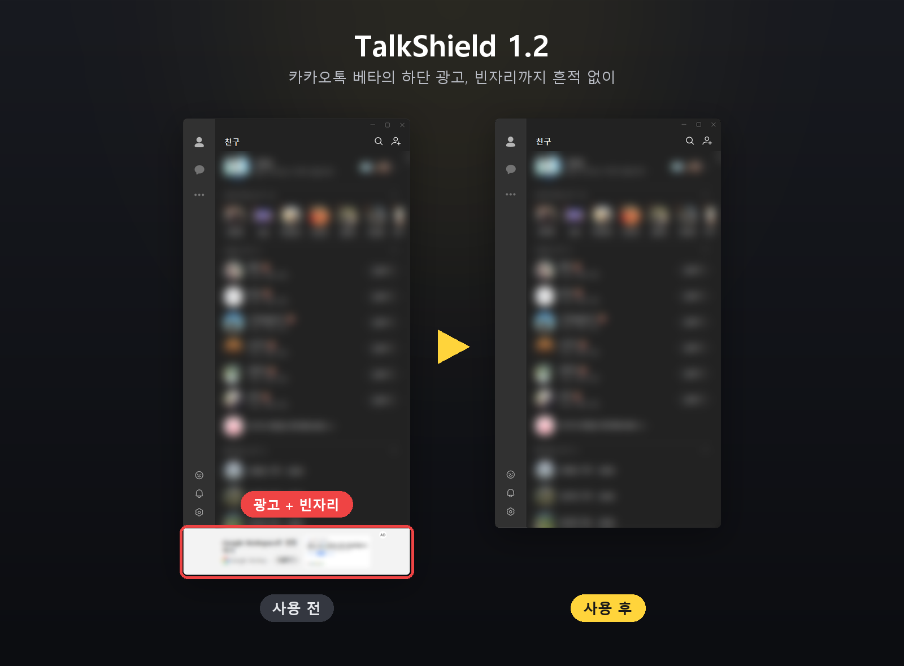
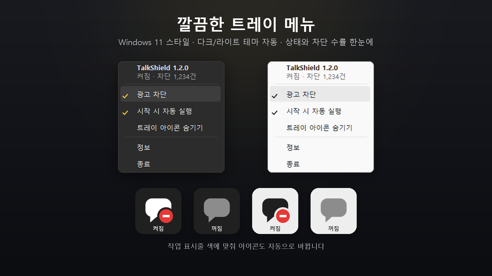

<div align="center">

<a href="https://youngsam.net/programs/talkshield-%ED%86%A1%EC%8B%A4%EB%93%9C"></a>

<br />

<a href="https://youngsam.net/programs/talkshield-%ED%86%A1%EC%8B%A4%EB%93%9C"></a>
&nbsp;
<a href="https://youngsam.net"></a>
&nbsp;
<a href="https://youngsam.net/programs"></a>

<br /><br />

[](https://youngsam.net/programs/talkshield-%ED%86%A1%EC%8B%A4%EB%93%9C)


[](LICENSE)

**실행해 두기만 하면, PC 카카오톡의 광고가 조용히 사라집니다.**
광고만 지우는 게 아니라 광고가 있던 **빈자리까지** 메우고, 창을 늘리고 줄일 때도 흔적이 남지 않습니다.

</div>

---

## 👀 한눈에 보기

<div align="center">

<br />
<sub>카카오톡 베타 · 사용 전 → 사용 후(다크 / 라이트) — 친구 이름·상태 글자는 가림</sub>
</div>

## ✨ v1.2 새로워진 점

<table>
<tr>
<td width="33%" valign="top">

### 🧪 카카오톡 베타 지원
새 PC 카카오톡(베타)의 **하단 배너 광고와 빈자리, 잠금화면 광고**까지 정리합니다. 기존 카카오톡도 그대로.

</td>
<td width="33%" valign="top">

### 🪟 창 조절도 깔끔하게
창을 늘리고 줄이거나 옮기는 동안에도 **광고 자리·테두리 줄·깜빡임**이 보이지 않습니다.

</td>
<td width="33%" valign="top">

### 🌗 다크 · 라이트
카카오톡 다크/라이트 모두 자연스럽게. **트레이 아이콘과 메뉴도 Windows 테마**를 따라갑니다.

</td>
</tr>
<tr>
<td width="33%" valign="top">

### 🪶 훨씬 가벼워짐
메모리(작업 집합) **약 47MB → 5~8MB**, CPU 사용량은 **약 1/3**로 줄었습니다.

</td>
<td width="33%" valign="top">

### 🎨 새 트레이 메뉴
Windows 11 스타일 메뉴. 현재 상태와 **누적 차단 수**를 맨 위에서 한눈에.

</td>
<td width="33%" valign="top">

### 🛡️ 더 튼튼하게
예기치 못한 오류에도 멈추지 않고, 끄거나 종료하면 **카카오톡 창을 원래대로** 되돌립니다.

</td>
</tr>
</table>

<div align="center">

</div>

## 🧹 제거하는 광고

| 광고 | 기존 카카오톡 | 카카오톡 베타 |
|---|:---:|:---:|
| 친구목록·채팅목록 **하단 배너 광고** (빈자리까지) | ✅ | ✅ |
| **잠금화면 광고** | ✅ | ✅ |
| 별도로 뜨는 **광고 팝업** (웹뷰 광고 포함) | ✅ | — <sub>(베타에는 현재 광고 팝업이 없음)</sub> |

채팅 내용·친구목록 같은 실제 콘텐츠는 건드리지 않습니다. 기존 카카오톡과 베타를 동시에 켜 둬도 각각 따로 처리합니다.

## 🚀 3초 시작

1. **[영삼넷에서 다운로드](https://youngsam.net/programs/talkshield-%ED%86%A1%EC%8B%A4%EB%93%9C)** — `TalkShield-vX.X.X.zip` 을 받아 압축을 풉니다.
2. `TalkShield.exe` 를 더블클릭합니다.
3. 끝. 카카오톡 광고가 자동으로 사라집니다.

설치가 없어서 지우는 것도 간단합니다 — 종료하고 파일만 지우면 끝. 새 버전이 나오면 트레이 알림으로 알려 드립니다.

> 💡 **트레이 아이콘이 안 보이면** — Windows 11은 새 프로그램 아이콘을 작업 표시줄 `∧`(숨겨진 아이콘) 안에 넣습니다. `∧`를 눌러 말풍선 아이콘을 **시계 옆으로 끌어다 놓으면** 항상 보입니다.

## 🖱️ 사용법

<div align="center">

</div>

트레이 아이콘을 **우클릭**하면 메뉴가 나옵니다.

| 메뉴 | 설명 |
|------|------|
| 광고 차단 | 차단 켜기/끄기 (아이콘 **더블클릭**으로도 전환) |
| 시작 시 자동 실행 | Windows 시작 시 자동 실행 등록/해제 |
| 트레이 아이콘 숨기기 | 아이콘만 감추고 차단은 계속. 다시 보려면 `TalkShield.exe` 한 번 더 실행 |
| 정보 | 프로그램 소개 페이지 열기 |
| 종료 | 프로그램 종료 |

- 아이콘에 **빨간 차단 배지**가 있으면 켜짐, **회색 말풍선**이면 꺼짐입니다.
- 시작·종료 알림 없이 조용히 동작하고, 설정과 누적 차단 수는 자동으로 저장됩니다.

## 🔒 안전한가요?

| | |
|---|---|
| 🧩 **인젝션 없음** | 카카오톡 프로그램 파일·메모리를 고치거나 끼어들지 않습니다. 화면의 **광고 창만** 정리합니다 |
| 📖 **전체 소스 공개** | 동작 방식은 이 저장소의 소스(`TalkShield.cs` 한 파일)로 누구나 확인할 수 있습니다 (MIT) |
| 🔌 **네트워크 최소** | 새 버전 확인(GitHub 최신 릴리스 조회) 외에는 통신하지 않습니다 |
| ↩️ **언제든 원래대로** | 차단을 끄거나 종료하면 카카오톡 창을 처음 모습으로 되돌립니다 |

<details>
<summary><b>⚙️ 동작 원리 (기술 설명)</b></summary>

<br />

**기존 카카오톡 (`KakaoTalk.exe`)**

1. 메인 창에서 광고 컨테이너(제목 없는 자식 창)를 찾아 `WM_CLOSE` 메시지로 닫습니다.
2. 친구목록·잠금화면 영역을 리사이즈해 광고가 있던 자리를 콘텐츠로 메웁니다.
3. 창 테두리를 끌 때는 TalkShield가 크기 조절을 대신 수행하고, 그동안 창 그리기를 잠가(`LockWindowUpdate`)
   배너 자리가 빈 채로 그려지는 순간을 없앱니다.
4. 별도로 뜨는 광고 팝업(웹뷰 내장 창)을 숨깁니다.

**카카오톡 베타 (`KakaoTalkUI.exe`, Qt Quick)**

1. 광고 창(WebView2)을 완전 투명 + 클릭 통과 창으로 만듭니다. (닫으면 빈 껍데기가 남으므로 닫지 않습니다)
   친구목록·채팅목록과 잠금화면 모두 같은 하단 광고 창을 쓰므로 함께 정리됩니다.
2. 메인 창의 보이는 영역(window region)을 광고 자리 위까지로 잘라 빈자리를 없앱니다.
   Windows 11 그림자·테두리는 원래 크기로 그려지므로 끄고, 둥근 모서리는 영역으로 직접 만듭니다.
3. 크기가 바뀔 때마다 Windows 테마 엔진이 창 영역을 초기화하지 않도록 잘라 두는 동안 `WS_DLGFRAME` 을 빼고,
   그만큼(7px) 밀리는 내용은 창 위치를 보정해 제자리에 둡니다. 최대화 중에는 원래 스타일로 둡니다.
4. 잘려서 사라진 좌·우·하단·상단 크기 조절 테두리는 보이지 않는 손잡이 창으로 되살립니다.

공통으로, 창 이벤트(WinEvent)로 즉시 반응하고 불필요한 검사·메모리 할당을 없애 장시간 켜 둬도 가볍습니다.

</details>

<details>
<summary><b>🛠️ 소스에서 직접 빌드</b></summary>

<br />

Windows에 기본 내장된 .NET Framework 컴파일러만 사용하므로 **아무것도 설치할 필요가 없습니다.**

```bat
git clone https://github.com/openr03/TalkShield.git
cd TalkShield
build.bat
```

`build.bat` 이 내장 컴파일러(`csc.exe`)로 `TalkShield.exe` 를 만듭니다.

</details>

## ❓ 자주 묻는 질문

<details>
<summary><b>백신이나 SmartScreen이 경고해요.</b></summary>

코드 서명이 없는 개인 개발 무료 프로그램이라 나타나는 일반적인 경고입니다. `추가 정보` → `실행`을 누르면 실행됩니다.
소스가 전부 공개되어 있으니 직접 빌드해서 쓰셔도 됩니다.
</details>

<details>
<summary><b>카카오톡 업데이트 후 광고가 다시 보여요.</b></summary>

카카오톡의 창 구조가 바뀐 경우입니다. [Issues](../../issues)나 이메일(info@youngsam.net)로 알려 주시면 빠르게 반영하겠습니다.
</details>

<details>
<summary><b>계정 제재 위험은 없나요?</b></summary>

TalkShield는 카카오톡 프로그램·서버·메모리에 개입하지 않고 내 PC 화면의 창만 정리하므로, 일반적인 창 관리 프로그램과 같은 방식으로 동작합니다.
다만 사용에 따른 책임은 사용자에게 있습니다.
</details>

<details>
<summary><b>컴퓨터가 느려지지 않나요?</b></summary>

메모리(작업 집합) 5~8MB 정도, 평소 CPU 사용량은 사실상 0%입니다. 카카오톡이 꺼져 있으면 검사 주기를 스스로 늦춥니다.
</details>

---

<div align="center">

<a href="https://youngsam.net"></a>

### 만든 사람 — 김영삼 · [영삼넷](https://youngsam.net)

개발자 블로그 **[영삼넷 youngsam.net](https://youngsam.net)** 에서 TalkShield 소식과 다른 프로그램을 만나 보세요.

<a href="https://youngsam.net"></a>
<a href="https://youngsam.net/programs/talkshield-%ED%86%A1%EC%8B%A4%EB%93%9C"></a>
<a href="mailto:info@youngsam.net"></a>

버그 제보·기능 제안은 [Issues](../../issues) 또는 이메일로 보내 주세요. 도움이 되셨다면 ⭐ 하나 눌러 주시면 큰 힘이 됩니다.

<sub>[MIT License](LICENSE) © 2026 김영삼 · 카카오톡(KakaoTalk)은 (주)카카오의 상표이며, TalkShield는 카카오와 관련 없는 개인 개발 프로그램입니다.</sub>

</div>
